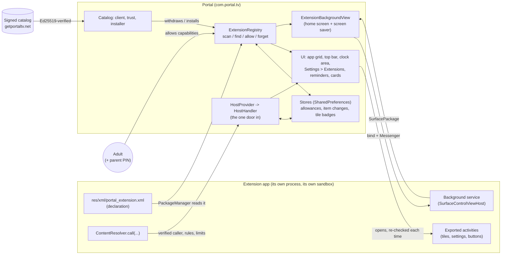
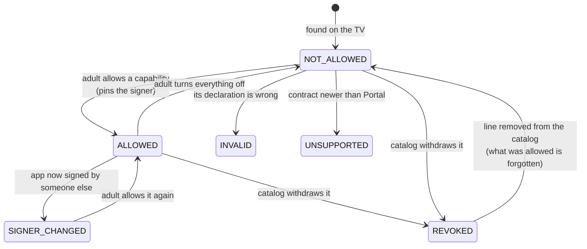
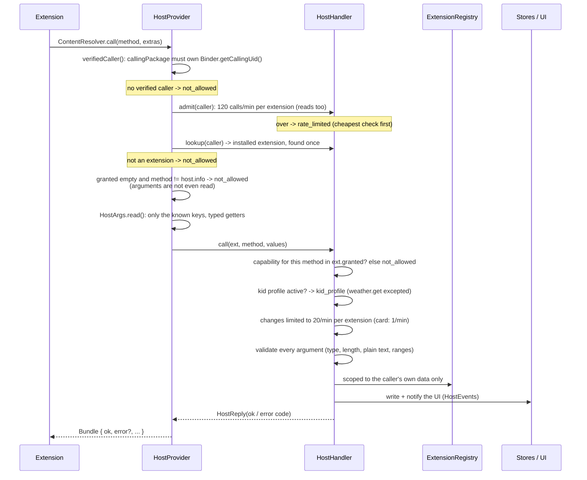
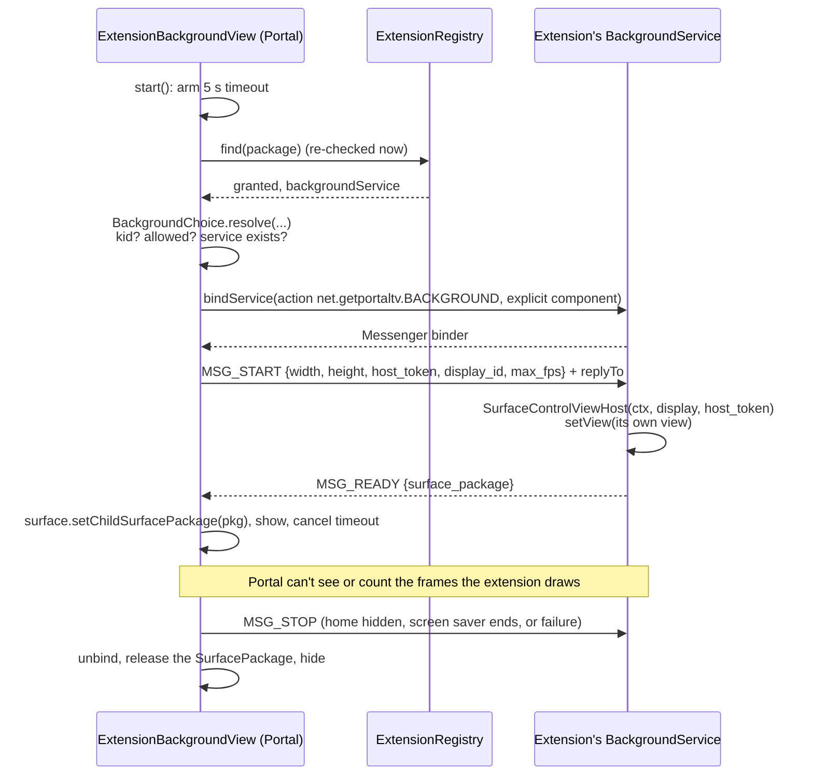
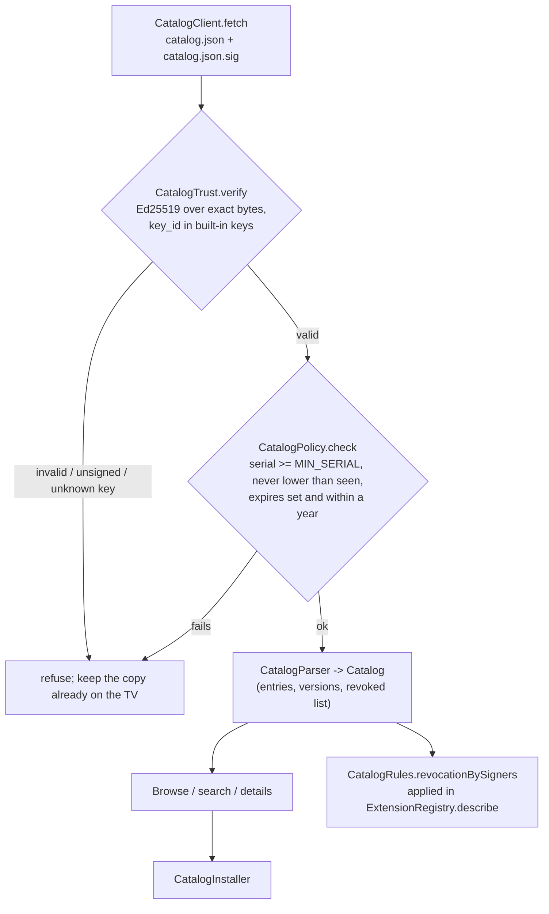

# Portal extensions: architecture

How extensions are built into Portal: what runs where, what is trusted and why, what is stored, and how a request from an
extension travels through the code. It is written for someone changing Portal or reviewing its security.

The other documents are for other readers, and this one does not repeat them:

- [`EXTENSIONS.md`](EXTENSIONS.md) is the **contract**: what an extension author writes (the manifest file, the capabilities, the
  host calls and their errors, the limits). Read it first if you want to write an extension.
- [`CATALOG.md`](CATALOG.md) is the **catalog format** and its signing, for people who publish or maintain the catalog.
- Scenic Travel, the one large extension, is its own project (Scenic-Travel) with its own README and architecture notes.

All the Portal-side code is in the package `com.portal.tv.extensions` (`app/src/main/java/com/portal/tv/extensions`), plus a few
places in the UI that draw what it decides (listed in [Where it meets the rest of Portal](#where-it-meets-the-rest-of-portal)).

---

## 1. What an extension is, and the three rules

An extension is an ordinary Android app. It adds a feature to Portal (a tile in the app grid, a settings page, buttons or text
on the home screen, reminders and cards, an animated background) without any change to Portal. It needs no SDK: it declares
itself in a small XML file, and talks to Portal through one `ContentProvider` call.

The whole design rests on three rules. Almost every class exists to enforce one of them.

1. **Portal never loads or runs an extension's code.** An extension is a separate APK in its own process under Android's sandbox.
   Portal *reads* what it declares and *draws* the result itself, in Portal's own style. The only pixels an extension draws
   itself are its background, and even that is drawn in the extension's process and shown through a `SurfaceView`; the
   extension supplies no view, class or script to Portal.
2. **Nothing happens until an adult says yes, one capability at a time**, and the yes is tied to the app's signing certificate.
   Found is not allowed. A capability added by an update stays off. A different signer means nothing is granted.
3. **Portal never believes a claimed identity.** Who is calling comes from Android (the calling uid), never from anything the
   caller sends. Every use of an extension is re-checked at the moment it happens: it is still installed, still signed by who was
   allowed, still allowed that capability.

A fourth idea follows from those: **everything that comes from an extension is untrusted text and pictures.** Names, labels,
card text, icons and catalog entries are checked for look-alike characters, size and length before they are shown
([Text and picture safety](#text-and-picture-safety)).

---

## 2. The big picture

There are two directions of traffic, and they use different mechanisms on purpose:

| Direction | Mechanism | Why |
| --- | --- | --- |
| Extension to Portal (do something) | `ContentResolver.call` on `content://net.getportaltv.host` | Needs no binding, no library and no long-lived connection. Android reports the caller's uid on every call. Portal keeps no state per connection. |
| Portal to extension (open a screen) | An explicit `Intent` to an exported activity the extension declared, started in the extension's own task | Portal asks Android to open the extension's screen; none of the extension's code is loaded into Portal. |
| Portal to extension (draw a background) | `bindService` with the action `net.getportaltv.BACKGROUND`, then a `Messenger` | The only case where Portal needs a reply (a `SurfacePackage`). It is a narrow three-message protocol ([section 7](#7-the-background-protocol)). |

---

## 3. Discovery: how Portal finds and reads an extension

**Entry point:** `ExtensionRegistry` (`ExtensionRegistry.kt`).

An app is an extension if its `<application>` carries the metadata key `net.getportaltv.extension` pointing at an XML resource.
`ExtensionRegistry.scan` asks `PackageManager` for installed applications with metadata, keeps the enabled ones that have the
key (never Portal itself), reads each, and returns them in name order. `find(packageName)` does the same for one package. Portal
holds `QUERY_ALL_PACKAGES`, so no per-package visibility declarations are needed.

### Reading the declaration

1. `XmlAdapter` turns the extension's XML resource (read through `getResourcesForApplication`) into a plain tree with
   `@string/...` and `@drawable/...` references resolved against the extension's own resources.
2. `ManifestParser.parse` (`ExtensionManifest.kt`) validates the tree and returns one of three results:
   `Ok(manifest)`, `Invalid(reason)` or `NeedsNewerPortal` (the `contract` number is higher than the version Portal speaks, currently 1).
   Parsing is a pure function with no Android types, so it is unit tested on the JVM.
3. The parser enforces the limits in the contract (ids, lengths, at most 8 tiles, at most 2 items per area), refuses text that fails
   `TextSafety`, and refuses any name that could pass for Portal or Android (`Impersonation`). Unknown elements are ignored so a
   file can carry things for a later contract version; anything wrong in the parts Portal does know is reported, not guessed at.
4. The capabilities an extension *asks for* are **derived from what it declares**: a tile asks for `tiles`, a `<settings>` element for
   `settings`, a bar or clock item for `bar` or `clock`, a `<background>` for `background`. Only `reminders`, `cards` and `weather`
   are asked for with an explicit `<uses capability="...">`. This stops an extension from declaring a tile while claiming it needs
   nothing.

### Checking that the screens exist

For each tile, button, settings page and background service, the registry asks `PackageManager` whether the named component exists,
is enabled and is **exported** (`canOpen`, `canBind`). One that fails is dropped and explained in the extension's `problems` list,
which the person sees on the extension's page. A private activity can therefore never be opened through Portal.

### The facts cache

Reading an extension costs resource loading, XML parsing and many `PackageManager` calls. The result (`Facts`) is cached per
package and keyed by a stamp made from the package's `lastUpdateTime` and whether it is enabled, so an update, reinstall or
enable/disable re-reads it.

What can change *without* an update is applied on top of the cached facts every time, in `describe`: what an adult allowed, the
item changes an extension made while running, and the catalog's withdrawn list. That split is why the cache is safe: nothing
security-relevant is cached across a change an adult makes.

### One resulting object

`describe` produces an `Extension` (package, parsed manifest, usable tiles, settings activity, usable items, background service,
problems, signer, **state**, **granted** capabilities, optional withdrawal reason, and `madeByPortal`). Everything else in Portal
asks the registry and gets this object; nothing else parses manifests or reads the allowance store directly.

---

## 4. Permissions and trust

### 4.1 Capabilities

A capability is a named thing an extension may do. The list is fixed in `Capability` (`ExtensionManifest.kt`); a name Portal does not
know is never granted.

| Capability | Asked for by | What it controls | Where it is enforced |
| --- | --- | --- | --- |
| `tiles` | `<tile>` | Tiles in the app grid; `tile.update` badges and subtitles | `ExtensionTiles`, `HostHandler` |
| `settings` | `<settings>` | A settings page opened from Portal's Settings | `ExtensionsPage` |
| `bar` | `<bar-button>` / `<bar-text>` | Items in the top bar | `ExtensionItems`, `HostHandler` |
| `clock` | `<clock-button>` / `<clock-text>` | Items under the time and weather | `ExtensionItems`, `HostHandler` |
| `background` | `<background>` | The home screen (and screen saver) background | `ExtensionBackgroundView`, `BackgroundChoice` |
| `reminders` | `<uses>` | Reminders owned by the extension | `HostHandler`, `ReminderService` |
| `cards` | `<uses>` | Cards over other apps | `HostHandler` |
| `weather` | `<uses>` | Read the current weather and the TV's rough location (to about 10 km) | `HostHandler`, `WeatherForExtensions` (`HostWeather.kt`) |

### 4.2 The state machine

`ExtensionAccess.state` (`ExtensionAccess.kt`) puts every extension in exactly one state:

`granted` is computed by `ExtensionAccess.granted(declared, allowance, signerMatches)`: the intersection of what the extension
**declares**, what an adult **allowed**, and, only while the signer **still matches**, otherwise nothing. A capability added by an
update is in `declared` but not in the saved allowance, so it stays off until an adult turns it on. A withdrawn extension is forced
to an empty set (`withRevocation`).

### 4.3 Signer pinning

When an adult allows an extension, `ExtensionRegistry.allow` saves an `Allowance(signer, capabilities)`. The signer is the SHA-256
of the signing certificate(s), from `GET_SIGNING_CERTIFICATES`. For an app with several signers the fingerprints are sorted and
joined, so the result does not depend on the order Android lists them in (`combineSigners`).

On every read, `signerMatches` compares the pinned signer to the current one. A mismatch is not a failure to be repaired; it is a
different app as far as trust goes, so `granted` is empty and the state is `SIGNER_CHANGED`. The one exception is a **legitimate key
rotation**: Android's own `hasSigningCertificate(pkg, pinnedBytes, CERT_INPUT_SHA256)` is true when the pinned certificate is in the
app's rotation history (a proof signed by the old key), and then what was allowed is kept.

### 4.4 Closing the "swap it while the page is open" gap

The Allow page shows a snapshot (signer and requested capabilities). `ExtensionRegistry.allow(..., checkShown = true)` re-reads
the extension and refuses to save if either has changed since the adult looked (`ExtensionAccess.sameAsShown`). Replacing the app
while the page is open therefore cannot obtain an approval for something the adult never saw.

### 4.5 Who can allow: the parent PIN

Changing what an extension may do is gated in `ExtensionsPage`: if a parent PIN is set it is asked for first; if none is set, one
must be created first (otherwise anyone on an adult profile could allow things). Reading an extension's page needs no PIN. Installing
from the catalog also asks for the PIN, before the download.

### 4.6 Kid profiles

| Surface | Rule on a kid profile |
| --- | --- |
| Settings, Extensions | Never shown |
| Tiles | Appear only if a parent allowed that tile for the kid (Manage apps). Tiles use a synthetic key `portal.ext:<package>/<tile id>` (`ExtensionTileKey`) in place of a package name, so hidden-app lists, grid order, Frequently Used and the parent's allow-list work **unchanged**. Bedtime and daily limits are checked before a tile opens, as for any app. |
| Top bar and clock items | Not shown |
| Tile badges and subtitles | Not shown (text from another app) |
| Host calls | Refused as `kid_profile`, except `weather.get`, because Portal already shows weather to kids itself |
| Background | Used only if a parent turned it on for that kid (`BackgroundSettings.kidCanPickExtension`) |
| Screen saver | Not profile-based at all: it belongs to the TV |

### 4.7 Withdrawal (revocation)

The catalog can withdraw an extension by package, by package and version, or by signer. `describe` matches the cached catalog's
withdrawals against each installed extension, using **every certificate in its signing history**, so rotating to a new key does
not dodge a withdrawal. A match makes the extension `REVOKED`: nothing is granted, what was allowed is forgotten, it cannot be
allowed again while withdrawn, and its page shows the reason with an Uninstall button. No network is needed to apply it: it uses the
copy already on the TV.

### 4.8 Reserved names and "made by Portal"

A package name that looks like Portal's own (a part that is `portal`, `portaltv`, `getportal`, `getportaltv`, or `portal` with
`settings`, `parental`, `launcher`, and so on) is **reserved**. `describe` treats such an extension as unusable unless some certificate
in its history is the same as Portal's own (`ownSigners`). The same signer test sets `madeByPortal`, which the UI shows as "Made by
Portal" instead of an unlisted-extension warning. This is why Scenic Travel (`net.getportaltv.scenic`) has to be signed with Portal's
release key to be usable.

### 4.9 The extension that ships with Portal

**Files:** `BundledExtension.kt`, `weather-extension/` (the extension), `weather-core/` (what it shares with Portal).

Portal fetches no weather itself: Open-Meteo, the National Weather Service and city search live in `net.getportaltv.weather`, an
ordinary extension. Its APK is built by Gradle and embedded in Portal's assets, and it is signed with Portal's release key. The
rules above are not loosened for it, with two exceptions that are narrow on purpose:

- **Installing.** Portal installs it through Android's own installer, so Android still shows its confirmation. Portal asks at most
  once for each of its own versions, and Settings, Weather has an "Install weather" button for anyone who declined.
- **Allowing.** The first time Portal sees the package `net.getportaltv.weather` installed **and** signed with the same key as
  Portal itself, it allows that one extension one capability, `weather-source`, without the PIN, so weather works out of the box.
  It is not a rule for "extensions signed by Portal": the package name is part of the test. It happens once; after that an adult
  can turn it off and Portal never turns it back on. If the package is uninstalled, what was allowed is forgotten like any
  extension's, and a fresh copy is allowed once again.

Its package name is reserved, and a reserved name is only usable when signed by Portal's key (4.8), so another app can't take its
place. Its name has no "Portal" in it, because Portal refuses any extension name that could pass for part of itself, its own too.

---

---

## 5. Text and picture safety

Everything an extension or the catalog supplies is displayed in Portal's own style, so it could be used to impersonate Portal
(a fake "Settings" button that opens a look-alike PIN screen). Three small objects defend against that.

- **`TextSafety`** (`TextSafety.kt`) defines "plain" text: visible, no control characters, no zero-width or direction-changing
  characters, no private-use or unassigned characters, no more than three combining marks in a row.
- **`Impersonation`** (`TextSafety.kt`, with `Confusables.kt`) refuses names that pass for Portal or Android. It matches whole words
  (settings, update, parent, pin, ...), those longer names anywhere once spaces and punctuation are ignored, look-alike letters
  mapped to Latin through Unicode's confusables list (about 1,800 characters, generated by `scripts/gen-confusables.py`), `i`/`l`/`1`
  and similar folds, whole alphabets with many look-alikes, and words that mix Latin with another alphabet. It also decides which
  package names are reserved. The exact rules are tabulated in `EXTENSIONS.md`, and the same code runs in
  `scripts/check-extension.sh` and the catalog validator, so an author can check before installing.
- **`SafeIcons`** (`SafeIcons.kt`) loads pictures from another app's resources with a hard limit (512 px a side, and the size a
  vector reports is checked too). Pictures are drawn in Portal's process on the home screen, so an oversized one could run Portal out
  of memory on every start. Anything too big or unreadable becomes a generic icon, and loading never throws.

---

## 6. The host API: the one door in

**Files:** `HostProvider.kt` (the door), `HostHandler.kt` (the rules), `HostRules.kt` (names, limits, checks, rate limiter),
`HostWeather.kt`, `ExtensionItems.kt`/`ItemOverrides.kt`, `TileDecorations.kt`.

Anyone on the TV can reach an exported provider, so it is built as a **door with no data behind it**: `query`, `insert`, `update`,
`delete` and `getType` all return nothing, and the only entry point is `call(method, arg, extras)`. The manifest declares it with
`android:exported="true"` and no permission, because the check is done by Portal on each call, not by Android.

### 6.1 The path of a call

Design points that matter for review:

- **Order is cost order.** Each step is cheaper than the next, so a flood of calls from a caller that is not allowed costs almost
  nothing: no registry lookup, no argument parsing.
- **The caller identity is verified twice.** `callingPackage` must be one of the packages that own the calling uid
  (`getPackagesForUid`), so a package name cannot be spoofed by an app that merely claims it.
- **Arguments are read defensively** (`HostArgs`). Only the keys in `HostApi.ARG_KEYS` are read, each through a typed getter, and the
  rest of the `Bundle` is never unparcelled, so a caller cannot make Portal deserialize an object it did not ask for. A value of the
  wrong type becomes `null`, which the handler treats as "given but wrong" and refuses (it is never read as "not given").
- **Ownership is structural, not checked after the fact.** Reminders carry a `source` package. `reminders.list/update/delete` look
  only in `env.remindersFrom(caller)`, and an update is written back with the original `id`, `profileId` and `source` regardless of
  what the caller sent. Items and tile badges are looked up only among the caller's own declared ids. There is no way to *name* Portal's
  own buttons, weather or alerts, so a call that tries gets `not_found`.
- **Serialised where it matters.** Adding a reminder takes a lock so two simultaneous calls cannot both see room for the 50th.
- **Failures are closed.** Any exception becomes `unavailable`; every refusal is verified by tests to have changed nothing.

### 6.2 Methods and what each needs

| Method | Capability | Notes |
| --- | --- | --- |
| `host.info` | none | The only call that works with nothing allowed. Returns the contract version, Portal's version code, what the caller has been granted, and the reminder limit. |
| `reminders.add/list/update/delete` | `reminders` | Reminders get a `source`; shown "from extension X"; max 50; built-in tones only; removed when the capability is turned off or the app is uninstalled |
| `card.show` | `cards` | Same card as reminders, headed "from extension X · package"; no buttons or sound; 1 a minute; shows a notification if the "display over other apps" permission is missing |
| `tile.update` | `tiles` | Badge (6 chars) and subtitle (24); only for the extension's own declared tile ids |
| `items.set/remove/list` | `bar` or `clock` (by the `area` argument) | Change words of declared items, remove them, add text lines, within 2 per area |
| `weather.get` | `weather` | Reads Portal's cached weather as numbers; never touches the network; location rounded to 0.1 degree; works on kid profiles |
| `weather.report`, `weather.alerts` | `weather-page` | The whole cached report (Portal's own JSON format, location rounded to 0.1 degree, with the city's name) and the alerts in force, for an extension that is the weather page; never touches the network; works on kid profiles |

Limits live in `HostLimits` (50 reminders, 80/60/140 character caps, 120 calls and 20 changes per minute, 8 item changes kept, a
reminder at most two years ahead). `RateLimiter` is a per-package sliding window kept in memory only, so a restart starts fresh.

### 6.3 Testability by construction

`HostHandler` does not touch Android. It talks to the world through the `HostEnv` interface (clock, extension lookup, active profile,
reminder store, item and tile stores, card display, weather). `HostProvider` supplies a `RealHostEnv`; tests supply a fake TV. That
is why the rules can be exercised thoroughly on the JVM ([section 10](#10-testing)).

---

## 7. The background protocol

An extension with `background` allowed can draw the home screen background (and the screen saver). This is the only place an
extension draws pixels, and it is done without running its code in Portal.

- **Who owns what.** Portal owns a `SurfaceView` and its `hostToken`. The extension builds a `SurfaceControlViewHost` against that
  token in its own process and returns a `SurfacePackage`; Portal attaches it as a child surface. Portal displays pixels; it never
  receives a class, a view or a drawable from the extension.
- **Never in the way.** The view is not focusable, not clickable, hidden from accessibility and invisible until the first picture
  arrives. It sits behind everything and under the same dark layer Portal puts over its own backgrounds, so text stays readable.
- **Size and rate are requests.** Portal asks for the screen size capped at 1920 by 1080 (`BackgroundChoice.size`) and passes
  `max_fps = 120`. It cannot count an extension's frames, so the extension must choose a sensible rate itself.
- **Safety net.** If the extension does not answer within 5 seconds, its process dies, it is no longer allowed or is signed by
  someone else, or it sends nothing, `ExtensionBackgroundView` runs `onFailed` once and Portal shows its own gradient. The choice is
  kept and tried again the next time the home screen opens.
- **Lifecycle.** The extension is stopped whenever the home screen is not showing (another app, the screen saver, the intro) and
  started again when it returns, so it costs nothing in the background.
- **`BackgroundChoice.resolve`** is a small pure function: kid without parent permission, no extension chosen, capability not
  granted, or no bindable service each give Portal's own background, with a reason.
- **Screen saver reuse.** `ScreensaverView` creates the same `ExtensionBackgroundView` with `followsProfile = false`. The screen
  saver is the TV's, not a profile's, so who is signed in (kid or adult) makes no difference. If the extension cannot be used, the
  screen saver falls back to Portal's shader.

---

## 8. Where it meets the rest of Portal

The extension code decides; these places draw or act on the decision.

| Surface | Code | How it uses extensions |
| --- | --- | --- |
| App grid | `AppRepository` | Appends `ExtensionTiles.appInfos(context)` to the installed apps. Each becomes an `AppInfo` whose "package" is the synthetic tile key, marked `isSystem` so there is nothing to uninstall. |
| Opening a tile | `HomeFragment.launchApp` -> `ExtensionTiles.resolve` | Re-checks the extension is installed, signed by who was allowed and still allowed `tiles`, then builds an explicit `ACTION_MAIN` intent for the declared activity in a new task. If any check fails the tile is refused and removed. |
| Top bar and clock items | `HomeFragment.refreshExtensionItems`, `ExtensionItemViews` | Scans on an IO thread (`ExtensionRegistry.scan`), `ExtensionItems.pick` selects items per area (4 in the bar, 3 under the clock, in extension name order), and Portal builds the views itself. Buttons resolve through `ExtensionItems.resolve`, re-checked on each press. Not shown for kids. |
| Live redraw | `HostEvents` | The host handler calls `itemsChanged()` / `tilesChanged()`; the home screen registers callbacks while it is showing and redraws at once. |
| Settings, Extensions | `ExtensionsPage` | Lists extensions with their state, shows signer/package/requested capabilities and the items it would put on screen, applies PIN-gated allow/deny, opens an allowed settings activity, and hosts the kid background switch. |
| Reminders | `ReminderStore` (`source` field), `ReminderService` | Reminders from an extension keep their package in `source`; the service drops one whose extension is no longer allowed `reminders`; the card says "from extension X". |
| Cards | `ReminderService.showCard` | The same card as reminders, with a `from` line that cannot pass for Portal. |
| Background | `ExtensionBackgroundView` in the home screen and `ScreensaverView` | [Section 7](#7-the-background-protocol). |
| Catalog | `ExtensionCatalogFragment`, `CatalogPages` | Browse, details, install, review. [Section 9](#9-the-catalog). |

The manifest declares three extension-related components: the exported `HostProvider`, a `PackageRemovedReceiver` for
`PACKAGE_FULLY_REMOVED`, and a non-exported `CatalogInstallReceiver` that receives Android's answer to an install.

---

## 9. The catalog

The catalog is how people find and install extensions from inside Portal. It is a **signed file on a web host**, and Portal does not
take the host's word for anything. The format is in [`CATALOG.md`](CATALOG.md); this section is how the pieces fit.

- **Trust root.** `CatalogTrust` holds the public Ed25519 key(s) built into Portal (`RELEASE_KEYS`); the private half is kept offline.
  Debug builds also trust a test key so tests and `scripts/test-catalog.sh` can sign. `Ed25519Verify` is implemented in the code
  rather than relying on the platform, so verification behaves the same on every Android version, and it is tested against the
  RFC 8032 vectors and the JDK.
- **A signature says who, not when.** `CatalogPolicy` adds a `serial` (never decreasing; Portal remembers the highest it accepted),
  an `expires` date (at most a year ahead), and an "effective now" that is the later of the TV's clock and the newest publication date
  of a signed catalog Portal has used, so a TV with a wrong clock cannot make an old catalog look current. When a catalog expires,
  installing pauses; listing and withdrawals still work.
- **Considerate client.** The request carries nothing about the TV. It asks "has it changed?" (`ETag`/`Last-Modified`), adds a
  per-TV random 0 to 6 hours of extra delay after a day, honours `Retry-After` on 429/503, and with no extensions installed never
  contacts the catalog unless the person opens Browse.
- **Install pipeline** (`CatalogInstaller`, rules in `CatalogInstallChecks`, which is pure): not withdrawn and a usable version exists;
  the installed app (if any) has the catalog's signer; "Install unknown apps" allowed; parent PIN; download over https (http only
  in debug) capped at the catalog's size; then **checks on the file itself**: size and SHA-256 match, package name and version code
  match, signer is the catalog's (and the installed app's, for an update), not withdrawn, newer than installed, is a Portal
  extension and asks for **no more than the catalog lists**. Android's own confirmation screen always comes last; Portal never
  installs another app silently. After install the extension arrives as "needs your permission", never allowed.
- **The catalog says what a file should be, and the file is checked to be that**, so a listing cannot be reviewed for one thing and
  ship another.
- **First-party entries.** Portal's own extensions are listed too. Names and package names that pass for Portal are allowed only for
  a listing whose signer is in `docs/catalog/first-party-signers.txt`.

---

## 10. What is stored, and how it is cleaned up

Nothing about extensions is in a database; it is a handful of `SharedPreferences` files and one cached file.

| What | Where | Notes |
| --- | --- | --- |
| What an adult allowed, and the signer it was pinned to | `portal_extensions` (`ExtensionStore`) | The same for every profile. JSON via `ExtensionJson`. |
| What each extension changed about its items while running | `portal_extension_items` (`ExtensionItemStore`) | Kept apart from the allowance; at most 8 changes per extension. |
| Tile badges and subtitles | `portal_extension_tiles` (`ExtensionTileStore`) | Removed when `tiles` is turned off. |
| Reminders made by an extension | The normal reminder store, with a `source` package | Removed when `reminders` is turned off, or on uninstall. |
| Chosen home screen extension background, and the kid switch | `BackgroundSettings` (`extension`, `kid_can_pick_extension`) | Turning the kid switch off puts the kid back on Portal's own background. |
| Chosen screen saver extension | `ScreensaverSettings` (`extension`, look `extension`) | |
| Last good catalog (signature line + catalog in one file) | `extension_catalog.json` in `filesDir`; fetch bookkeeping in `extension_catalog` prefs | |
| Rate-limit windows | Memory only | A restart starts fresh. |

**None of this is backed up or transferred.** `backup_rules.xml` and `data_extraction_rules.xml` exclude the allowance, item, tile
and catalog files: an allowance is tied to each app's signer and to what is installed *on this TV*, so restoring it elsewhere would
be meaningless at best and a way to inherit trust at worst.

**Cleanup is layered so nothing is left behind:**

1. `PackageRemovedReceiver` (on `PACKAGE_FULLY_REMOVED`) calls `ExtensionRegistry.forget`, which clears the allowance, item changes,
   tile badges and reminders.
2. `ExtensionRegistry.scan` also runs `forgetUninstalled` on every scan, covering a missed broadcast and an extension that was never
   allowed but left reminders or item changes behind.
3. `ExtensionRegistry.allow` takes back what a capability made when that capability is turned off (reminders, an item area, tiles).
4. A *disabled* app keeps what it was allowed; only uninstalling forgets.

---

## 11. Testing

Because the host API is open to every app on the TV, "refused" is something the project tests rather than assumes.

- **Rules on the JVM** (`app/src/test/.../extensions/`). `HostConformanceTest` runs the real `HostHandler` against a fake TV: unknown
  caller, nothing allowed, each capability opening only its own calls, a kid profile, one extension reaching for another's or Portal's
  reminders, names claimed in arguments, every kind of bad value, the 50-reminder and 2-item limits, rate limits, Portal's own buttons
  under every name, and 3000 random calls that must never throw. Every refusal is checked to have changed nothing. Other suites cover
  the manifest parser, access and signer rules, items and tiles, text safety and confusables, catalog parsing, trust, install checks,
  revocation, search, and Ed25519.
- **Real IPC on an emulator** (`scripts/conformance.sh`, run in CI for every pull request). It installs Portal, `sample-extension` and
  `conformance-extension` (a deliberately misbehaving app, `net.getportaltv.rogue`) and checks what only Android can show: the shell
  cannot call, an extension signed by someone other than the allowed signer is refused, a kid profile is refused, other apps'
  reminders cannot be touched, a spoofed `source` is ignored, wrong types and a 200 KB value are refused, a flood is limited, and
  uninstalling removes what the extension made.
- **Author tooling.** `scripts/check-extension.sh` runs Portal's own name rules on an extension before install;
  `scripts/validate-catalog.sh` runs them on a catalog listing; `scripts/test-catalog.sh` serves a signed test catalog to a debug build.
- **Reference extensions.** `sample-extension` is a complete example (tile, settings, bar and clock items, reminders, cards, background
  in about 80 lines). Scenic Travel (a separate project) is a full-size one.

---

## 12. Decisions worth knowing, and what is deliberately not here

- **A `ContentProvider` rather than a bound service for the host API.** No connection state, no library for authors, and Android
  attaches the caller's uid to every call. The cost is that every call must re-check everything, which is what the pipeline in
  section 6 does.
- **A declarative XML file rather than code.** It is what lets Portal draw everything in its own style and never run foreign code.
  The price is that extensions cannot add arbitrary UI to Portal's screens; they can open their own screens, which Portal then
  treats as just another app.
- **Home screen items are data, not views.** The profile, search, settings and update buttons, the weather and any alert or kid
  time-left text cannot be named by an extension, so they cannot be removed, hidden or changed. The Settings button must always
  remain, because it is how an adult turns an extension off.
- **Trust is per capability and per signer, never per name.** A name is for people; the signer and package are what Portal checks.
- **Not included (yet):** AI-search tools contributed by extensions, other contract versions (the contract is version 1 and only
  ever grows; an existing attribute or capability never changes meaning), a web page for browsing the catalog, and any extension
  that runs inside Portal's process.
- **Extensions are third-party apps.** They are not covered by Portal's no-ads, no-tracking promise, and Portal says so where an adult
  turns something on.
