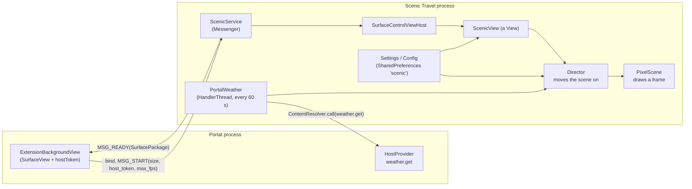
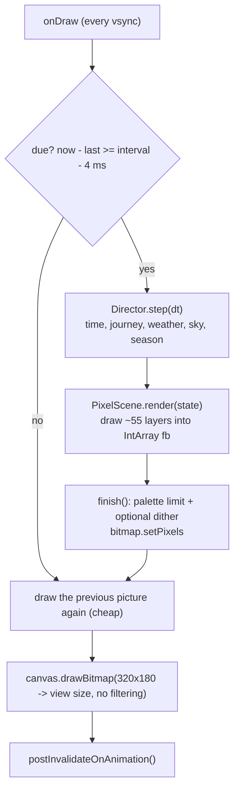

# Scenic Travel: architecture

How the Scenic Travel background works: how it gets onto the screen, how a frame is built, how the world and everything that
moves in it is worked out, and how to add to it. It is for someone changing the scenery or chasing a performance problem.

Scenic Travel is the largest Portal extension and the reference for the background protocol. Its user-facing description is in
[`../scenic-background/README.md`](../scenic-background/README.md); the extension system it plugs into is described in
[`EXTENSIONS-ARCHITECTURE.md`](EXTENSIONS-ARCHITECTURE.md) (contract in [`EXTENSIONS.md`](EXTENSIONS.md)).

Code: `scenic-background/src/main/java/net/getportaltv/scenic/` (about 7,000 lines of Kotlin, no libraries). Package `net.getportaltv.scenic`.

---

## 1. The idea in one page

Scenic Travel is a 320 by 180 pixel picture of a side-scrolling journey: countryside, forest, suburbs, a city, an amusement park and
a beach, under a sky that follows the real sun, moon, date and weather. The picture is drawn in software into an integer array,
reduced to a limited palette, and scaled up whole so every pixel is a clean square on the TV.

Four design choices explain almost everything in the code:

1. **The world is a pure function of position and time.** Nothing about the scenery is stored. A tree, a car, a whale and a
   firework are all computed from where the camera is and what time it is, using a repeatable hash (`Noise`). The same place always
   looks the same, scrolling backwards would work, and there is nothing to save, load or get out of sync.
2. **Everything is layered with its own speed.** Each layer scrolls at a fraction (or a multiple) of the road's speed, which is
   what makes a flat picture feel deep.
3. **Places blend by amount, never by switch.** "How much forest / city / beach is there *here*?" is a number from 0 to 1 at every
   point along the road. Each piece of scenery asks that question at its own position, so nothing pops in or out as one place
   becomes the next.
4. **A slow TV is the budget.** The target device has a weak CPU. The renderer avoids per-call overhead (no `Canvas` for the scene),
   caches what only changes as the view slides, and steps its frame rate down if it cannot keep up.

---

## 2. How it gets onto the screen

Scenic Travel is an ordinary Android app that Portal treats as an extension with three capabilities (`weather`, `settings`,
`background`, see `res/xml/portal_extension.xml`). It has no launcher icon. Its manifest exports two things: `SettingsActivity` and
`ScenicService` (action `net.getportaltv.BACKGROUND`), and declares a `<queries>` entry so it can see Portal's host provider.

1. Portal binds `ScenicService` and sends `MSG_START` with the size, a host token, the display and `max_fps`.
2. `ScenicService.start` creates a `SurfaceControlViewHost` on that token and display, puts a `ScenicView` inside it and replies with
   the host's `SurfacePackage`. From then on Portal only displays pixels; the drawing runs entirely in Scenic's process.
3. The service reads `Config` from preferences and **keeps a preference listener registered**, so a change in Scenic's settings
   (frame rate, dithering, place...) takes effect on the running picture at once, without a restart.
4. `MSG_STOP`, an unbind, or the service being destroyed calls `release()`, which drops the listener and releases the host.

The same service also draws the **screen saver** when it is chosen as the TV's screen saver, with no difference in Scenic's code:
Portal starts and stops it the same way.

Scenic gets the weather the only way an extension can: `PortalWeather` runs a `HandlerThread` that calls `weather.get` on Portal's
host provider every 60 seconds and publishes the result for the drawing thread (a `@Volatile` snapshot). Before Portal has ever
answered, defaults apply (a longitude guessed from the time zone, clear weather). Because Portal rounds the location to about
10 km, the sun and moon are right to within a fraction of a degree, but never reveal a street.

Scenic's package name is reserved for Portal's own apps, so it only works when signed with Portal's release key (see the trust
rules in the extensions architecture document).

---

## 3. Anatomy of a frame

`ScenicView` is a plain `View` whose `onDraw` runs on every screen refresh but does real work only when a frame is due.

- **Pacing.** The picture is *presented* every refresh but *worked out* only when its turn comes, a little early allowed
  (`EARLY_NANOS` = 4 ms) so a refresh that lands slightly before the due time does not cost a whole extra interval. The rate is
  therefore a steady whole number of refreshes apart, instead of whatever a timer lands on. On the real TV (60 Hz panel) 60 is the
  most that can ever be seen; 90 and 120 are accepted but cannot show on a 60 Hz screen.
- **Adaptive quality.** The view aims for `min(Config.fps, max_fps)` and keeps a moving average (`ema`) of how long a frame takes. If
  the average passes 85% of the budget it steps down the ladder `120, 90, 60, 30, 20, 15, 10`; if it stays under 75% of the next step up
  for long enough it steps back up. At 15 fps or less the rain and snow are thinned to half (`particleScale`). The first 60 frames
  are not counted, because the JIT is still warming up.
- **Scaling.** The 320 by 180 bitmap is drawn to the view's rectangle with `isFilterBitmap = false`, so each pixel becomes a clean
  square (a 6x6 block at 1920 by 1080).
- **Time step.** `dt` is clamped to 0.25 s so a stall cannot throw the world forward.

### What `Director.step` does

`Director` owns the one `SceneState` (reused every frame, nothing allocated per frame) and advances it in a fixed order:

1. **Time and journey.** `time += dt`; if scrolling is on, `cam += speed * dt` (base speed 30 pixels a second of the nearest
   layer, times the preview's speed multiplier).
2. **Weather.** The target is Portal's weather (or the chosen preset). The live `Conditions` *ease* toward it: time constant 45 s for
   real weather, 6 s when a person picks one, so a front arrives over a minute or so instead of jumping. The very first frame starts
   already in the target weather.
3. **Wind and clouds.** Wind direction decides which way the clouds drift.
4. **Snow cover.** Settles while it snows in the cold, melts slowly, and never falls below the season's "lying" snow.
5. **Sky.** The moment is the real time or "today at the chosen hour". `Astronomy` gives the sun's and moon's altitude and azimuth for
   that moment and place; `Look.update` turns the sun's height plus the weather into every colour the scene needs.
6. **Lightning.** Stateless, from time and storm strength (`Director.lightning`).
7. **Season and dates.** `Seasons.update` turns the day of the year into leaf, autumn, bloom and winter amounts, and the calendar sets
   `christmas` and `newYear`.

`SceneState` is the *only* thing handed to drawing. It is deliberately small: time, camera position, weather, sky, season, a few
cached per-frame lists, and a few pieces of state that are genuinely stateful (see [section 7](#7-how-things-move-and-happen)).

---

## 4. The world model

### 4.1 Layers and parallax

Everything is drawn back to front. A layer's **factor** says how fast it scrolls relative to the road (`cam`): small is far, large
is near. The main ones:

| Layer | Factor | Notes |
| --- | --- | --- |
| Sun, moon, stars, clouds | own drift | Clouds also drift with the wind |
| Far mountains, near mountains | 0.045, 0.08 | |
| Far hills + tree line, near hills + tree line | 0.10, 0.26 | |
| Farm, suburbs blocks, city blocks, rides | 0.5 | The "middle ground" |
| Roadside trees | 0.9 | |
| Road, traffic lane markings, beach front, parked cars | 1.0 | The reference speed |
| Front trees (two rows) | 1.15, 1.3 | In front of the road |
| Power poles and wires | 1.7 | Foreground |
| Grass tufts | 2.0 | Nearest |

Drawing order in `PixelScene.render` (about 55 named phases) is: sky, stars, sun, moon, sky life, clouds, mountains, hills, tree lines,
skyline; then the *ground* of each place (field, city, beach, suburb, park); then the middle ground (railway, farm, suburb blocks,
park rides, city blocks, lamps, beach front); then people, roadside trees, mist, depth fog; then fence, road, traffic, bridge,
walkers, birds, bats, fireflies; then front trees and foreground; then rain, snow, fog and lightning; last, `finish()`. Each phase is
wrapped in `phase("name") { ... }` so a debug build can time it.

### 4.2 Places: "how much of this is here?"

`Places.kt` is the heart of the world model.

- **A stretch** of the journey is 4,500 pixels of travel (about two and a half minutes). Stretches follow a fixed sequence that
  repeats: countryside, forest, countryside, **suburbia, city, suburbia, amusement park**, countryside, **beach**.
- **A blend** of 1,500 pixels (about a minute) is centred on each boundary. `Places.along` mixes the value of the stretch before
  and after with a smoothstep across the blend, and returns exactly the stretch's value in between.
- `Places.amount(place, journey, mode)` returns 0 to 1. In **Journey** mode it follows the sequence; picking one place in settings
  makes that place 1 everywhere.
- The amusement park and the suburbs next to it are *shaped* rather than blended, so the park's car park is a window in the middle of
  its stretch and the suburbs run straight into it with no countryside between (`Places.suburbia`, `Places.amusement`).

Pieces of scenery do not ask "which place am I in"; they ask for the amount at **their own position**, through helpers such as
`cityAt(x, factor)`, `forestAt`, `beachAt`, `suburbAt`, `parkAt`. The `factor` argument matters: a layer moving at factor 0.5 stores
positions in its own world, so the helper divides by the factor to get back to journey distance.

> **The parallax trap.** Two things at different factors that are on screen at the same x are at *different* journey positions. A
> house on the 0.5 layer and a parked car on the 1.0 ground at the same screen column are sampling different amounts of the same
> place. Early beach and suburb bugs (mountains over the sea, trees floating on sand, parked cars over houses) were all this. The
> fixes follow two rules: **anything ground-locked uses factor 1.0** so it slides exactly with the sand or road, and **anything that
> must not overlap another layer's object asks that layer's own amount at the object's own position** (as the car park does for houses).

### 4.3 Screen-aligned columns

Some things have to be decided per screen column: the sea's edge, the sand, the city's ground, the car park. Computing a place amount
for every column every frame would be wasteful, so `SceneState.prepareColumns()` (in `Beach.kt`) keeps a `Strip` for each place.

A `Strip` (`Strip.kt`) is a window of world columns whose values depend only on where they are in the world. As the view slides along,
only the columns that just came into view are computed; the rest are shifted down the array. `prepareColumns` fills `beachCols`,
`cityCols`, `suburbCols` and `parkCols` for the current screen (plus a few spare), and sets `anyBeach`, `anyCity`, `anySuburb`,
`anyPark` so a whole place's drawing can be skipped when none of it is in view. The beach strip is wider because the bay's curve
reaches 150 columns either side.

### 4.4 Time, sky and light

- **`Astronomy`** computes the sun's and moon's altitude and azimuth, and the moon's phase and lit side, with low-precision formulas
  (a fraction of a degree), tested against known dates.
- **`Look`** is the single place where light is decided. From the sun's altitude it interpolates sky colours between keyframes
  (night through dusk, sunrise, day), then layers weather on top: grey overcast (`deck`), rain, snow, fog, haze and lightning. It
  produces the sky gradient, the tint every layer takes (`tintR/G/B`), cloud light and shade, fog colour and star visibility.
  Sunrise, sunset, dusk, overcast and fog all come out of the same few numbers, so they change smoothly together.
- **`PixelScene.lit` / `solid` / `filter`** apply that light. `lit(base, air)` multiplies a colour by the tint, whitens it by snow cover,
  and mixes in haze (`air`: more for distant layers). `solid` is the same for things snow doesn't settle on (walls, wires, water).
  `filter` makes a `Tint` for sprites. Every drawn colour goes through one of these, so the whole scene is lit consistently.
- **`Season`** turns the day of the year into smooth amounts (leaf, autumn, bloom, winter, lying snow, field and hill colours),
  turned round in the southern hemisphere and left alone in the tropics. It also sets date-driven flags that are *not* climate:
  Halloween, festive lights, Christmas, New Year.

---

## 5. Rendering

### 5.1 A software framebuffer

The scene is drawn into `fb: IntArray(320 * 180)`. There is no `Canvas` in the scene. On the target TV each `Canvas` call costs
far more to set up (a few microseconds) than the few pixels each one fills, and a frame makes thousands of calls. Rewriting the
primitives to write straight into the array took a frame from about 50 ms to about 8 to 10 ms on the real TV.

The primitives are in `PixelScene.kt`:

- `fill(x0, y0, x1, y1, color)` clips, then `Arrays.fill`s each row (and steps down a column for 1-pixel-wide fills, which is how
  mountains and hills are drawn).
- `fillAlpha` blends a rectangle, using `d255` (divide by 255 without a division, which is slow on this CPU).
- `fillOval` / `fillCircle`, `line`, `dot`.
- `blit` draws a **sprite** with a tint and alpha. `sprite(sp, x, bottom, flip)` is the normal call (`bottom` is the feet);
  evergreens get a frost overlay as snow builds up.
- A `clipCols` mask restricts drawing to certain columns (used to keep the train on the stretch of track that runs alongside).

### 5.2 Sprites as text

Small pictures are written as rows of characters with a palette (`Sprite(rows, palette)`), one character per pixel, `.` empty. They
are baked into bitmaps once, and colour and light are applied when drawn. Cars are one sprite with a placeholder body colour
that is replaced when each colour variant is baked. `SeasonalTree` derives autumn, bare and blossom variants from a green tree by
recolouring its leaf pixels, with each tree's dates coming from a seed so leaves turn over weeks, not all at once. Larger or
animated shapes (a ferris wheel, a roller coaster track, a whale) are drawn from primitives each frame.

### 5.3 The palette and `finish()`

After everything is drawn, `finish()` limits each colour channel to `levels` steps (default 10) through a lookup table and, if
**dithering** is on, applies a 4 by 4 ordered (Bayer) pattern first. The default is clean colour bands (no dither); dithering is a
setting. `bitmap.setPixels` hands the result to the view.

---

## 6. Performance techniques

Everything below exists because of one weak TV. The numbers are from profiling on it.

| Technique | Where | What it saves |
| --- | --- | --- |
| No `Canvas` in the scene; direct `IntArray` writes | `PixelScene` primitives | The biggest win (50 ms to 8 to 10 ms a frame) |
| `Strip` caches for mountains, hills, place amounts | `Strip.kt`, `mountainRange`, `prepareColumns` | Only newly visible columns are recomputed |
| `any*` flags skip whole places off-screen | `prepareColumns` | Beach, city, suburb, park cost nothing when absent |
| `d255` instead of division | blend primitives | Division is slow on this CPU |
| Facts computed once a frame, not per column | `findBridges`, `findParks`, `prepareColumns` | Far scenery asks many times |
| Vsync-paced rendering with a small "early" allowance | `ScenicView.onDraw` | Even frame spacing, no wasted refreshes |
| Adaptive frame rate and thinned particles | `ScenicView.renderFrame` | Lower rate instead of stutter |
| `Profile` (debug builds only) | `Profile.kt`, `phase(...)` | Per-phase milliseconds and draw counts, logged every 5 s with tag `Scenic` |

A debug build logs `frame average X ms, worst Y ms` and the slowest phases, which is how every performance change here was measured.
The journey's transition scenes (several places at once on screen) are the most expensive frames.

---

## 7. How things move and happen

There are only a few mechanisms. Pick the one that matches what you are adding.

### 7.1 Stateless periodic events: `LifeSchedule`

For things that come and go (a deer, a plane, a firework, a train, a rabbit, gulls), `LifeSchedule.events(time, slotSeconds, lifetime,
probability, key, boost)` cuts time into slots; each slot has an event with a given probability starting somewhere inside it; the
event lives for up to `lifetime` seconds. It returns the events active *now*, each with its spawn time and a `unit(n)` that gives
repeatable variation. Nothing is stored: ask again next frame and the same event is there, a little older. `boost` (preview) gives
every slot an event so a rare thing can be looked at.

An event's position is usually worked out from its age: `x = start + velocity * age`, minus a fraction of the journey speed so it
slides against the scenery.

### 7.2 Position-anchored scenery

For things fixed to the world (a house, a tree, a ride, a lamp, a parked car), the position is derived from the world coordinate:
divide the layer's world into cells, and use `Noise.unit(cell, key)` to decide whether and where each cell has something and what
it looks like. Scroll position selects which cells are on screen. This is how every house, tree and lot is placed.

### 7.3 Periodic animation by time

Anything cyclic is a function of `s.time`: a flame's flicker, a ferris wheel's angle, a drop tower's phases, a carousel horse's bob,
a sailboat's sway. The amusement park keeps its own clock, `rideTime`, that advances by `dt * running()`, where `running()` falls to 0 in
a storm or gale, so the rides slow and stop smoothly instead of jumping.

### 7.4 Gradual change

Weather uses exponential approach (`Conditions.approach`). Places and seasons use smoothsteps over distance or days. Snow cover is a
state variable that accumulates and melts. The common thread: **nothing changes by a switch.**

### 7.5 Deliberately stateful events: once per visit

A few events must happen at most once per visit to a place, which a stateless schedule cannot promise. They keep a few fields in
`SceneState`, reset when the place is left:

- **Santa** on Christmas night in the city: `santaAt` / `santaSeen`.
- **The beach**: `beachVisit` counts visits; on each visit a breaching whale (`whaleAt`) and a shark's fin (`finAt`) may be
  scheduled at a random moment, each with its own probability.
- **The park's rides**: `rideTime` / `rideLast`.

### 7.6 Dates and weather as gates

Many things are gated by season or weather: Christmas lights and the sleigh, Halloween pumpkins, New Year and summer-night fireworks
(`Fireworks.kt`), pumpkin fields and haystacks (`Seasonal.kt`), rain umbrellas, closed rides, fewer people in storms. The gates read
`season.*`, `cond.*` and `look.day`, and most are smooth (an amount, not a flag) so they fade rather than pop.

---

## 8. The code, file by file

| File | What it holds |
| --- | --- |
| `ScenicService`, `ScenicView` | Answering Portal; the view, pacing and adaptive quality |
| `Director`, `SceneState` | One frame's state and how it advances |
| `PixelScene` | The renderer: framebuffer, primitives, the render order, sky, mountains, hills, field, road, traffic, rain and snow, `finish()` |
| `Places`, `Beach` (columns), `Strip` | Where each place is, the screen-aligned column caches |
| `Astronomy`, `Look`, `Season`, `Conditions` | Sun and moon, light, the year, weather and its easing |
| `PortalWeather`, `Settings`, `SettingsActivity` | Reading Portal's weather; saved choices; the settings page with its live preview |
| `Life`, `LifeSprites`, `LifeSchedule` (in `Life.kt`), `People`, `CityLife` | People, animals, vehicles, the schedule mechanism |
| `Forest` | Forest trees, mist, campsites |
| `City` | Skyline, blocks, lamps, crossings, subway, the clock tower |
| `Suburbia` | Houses, yards, commercial districts, decorations, pools, school bus, emergency traffic |
| `Beach` | Sea, bay, shore, boardwalk, pier, umbrellas, players, swimmers, boats, gulls, pelicans, whale, shark fin, lighthouse |
| `Amusement` | Car park, gate, carousel, ferris wheel, roller coaster, drop tower, swings, stalls, visitors |
| `Seasonal`, `Fireworks`, `Santa` | Flowers, haystacks, pumpkin fields, migrating geese; fireworks; Christmas sleigh |
| `Bridge` | The covered bridge and its river |
| `Sprites`, `Colors`, `Noise` | Text-drawn pictures; colour helpers; repeatable hashing |
| `Profile` | Debug-only phase timing |
| `src/debug/.../PreviewActivity` | The debug-only full-screen preview |

---

## 9. Settings, preview and tools

**Settings** are saved in the `scenic` preferences (`Settings.kt`) and read into a `Config`: real or chosen weather and time, scrolling
on or off, place, style, season, frame rate (15, 30, 60, 90, 120; default 60) and dithering (default off). `SettingsActivity` is the page
Portal opens from Settings, Extensions, with a live preview.

**The preview** (`PreviewActivity`, debug builds only) runs the scene full screen with keys to scrub time and weather. Its intent extras are how pictures
are taken and compared without waiting for the journey: `--es place`, `--ef hour`, `--es weather`, `--ef yearday`, `--ef cam` (start that
far along), `--ef at` (jump the scene clock), `--ez freeze true` (stop the clock so a frame is identical each time),
`--ez scroll false`, `--ez boost true` (everything that comes and goes is present), `--ez hide_readout true`, `--ei days`, `--ez yearlapse true`.

**Parity checks.** With `freeze` on, the same state draws the same frame, so a change meant to be invisible (a performance rewrite, say) can be
checked by capturing before and after and comparing the images at 320 by 180.

**Tests** (JVM, `scenic-background/src/test`): astronomy against known dates, conditions easing, the director's step, the life schedule,
light, places (including the sequence and blend), and seasons. Visual work is checked by capturing the preview on an emulator.

---

## 10. Adding to it

### A new element in an existing place

1. Decide the **layer factor**: ground-locked things (props on sand, parked cars) use 1.0; middle-ground buildings use 0.5.
2. Decide how it is placed: cells with `Noise.unit` (anchored scenery), `LifeSchedule` (comes and goes), or a time function (cyclic).
3. **Gate it by the right place amount at its own position** (`xAt(worldX, factor)`), and skip drawing when the place is absent
   (`anyBeach` and friends, or an early return).
4. Colour it through `lit` / `solid` / `filter` so it takes the light, haze and snow.
5. Insert its draw function at the right point in `PixelScene.render`'s order (behind what should cover it), wrapped in `phase(...)`.
6. Make it gradual: fade with an amount or season rather than switch, or appear at full size one object at a time (as street lamps now
   drop out), never shrinking.
7. Check it in the preview at several times, weathers and seasons, and at the transitions in and out of its place.

### A new place

1. Add the constant to `Places`, a position in the `SEQUENCE`, an `amount` function and `xAt` / `xNow` helpers; add it to `CHOICES`
   (the settings list reads it) and to `hardAt` / `hardNow` if it should push out farms, fences and animals.
2. If it needs per-column ground, add a `Strip` and columns to `SceneState` and `prepareColumns` (and an `any*` flag).
3. Write its ground and blocks, and insert them in the render order. Think about its entry and exit: what does the neighbouring
   place do while this one fades in? (The suburbs and car park needed their amounts shaped so houses and cars never overlap.)
4. Update `PlacesTest` for the new sequence, and gate traffic and people on the new amount if the road should feel different.

### Performance checklist

Draw with the primitives, not `Canvas`. Avoid per-frame allocation (reuse arrays, build sprites once). Skip whole phases when their
place is off-screen. Do work that depends only on the world once per new column (`Strip`). Measure with a debug build on the TV: the
log tag is `Scenic`.

---

## 11. Known limits

- The panel on the target TV is 60 Hz, so frame-rate settings above 60 cannot show; they exist for other displays.
- The weather arrives once a minute and eases in, so a real change shows after about a minute.
- Location is rounded to 0.1 degree by Portal; sun and moon positions are good to a fraction of a degree, which is plenty for a picture.
- The picture has one renderer so far (`8-bit`); the settings have a style list ready for more.
- Some scenes are only partly verified in motion on the real TV (for example the roller coaster train and rides closing in storms);
  those were checked in still captures on an emulator.
